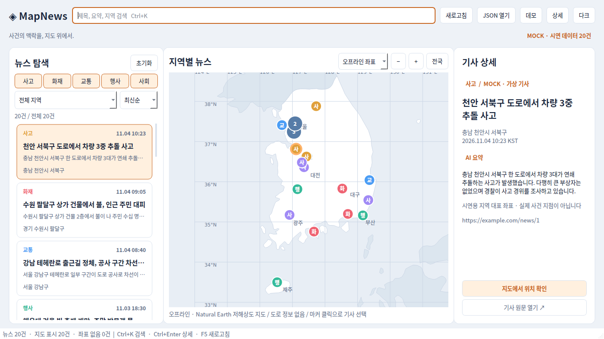
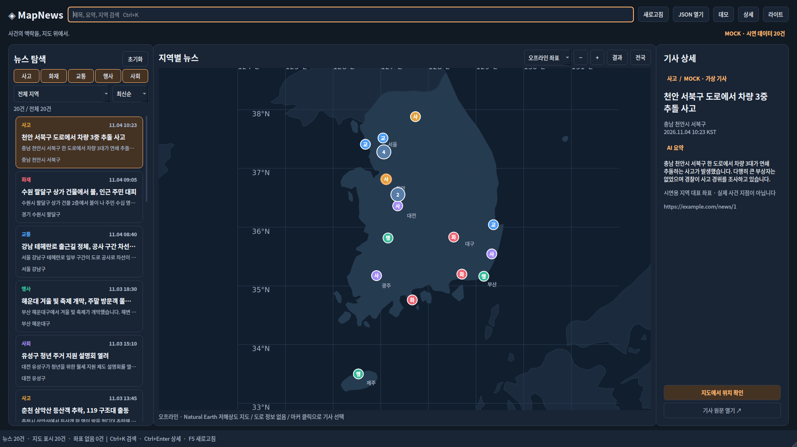

# 검증 기록

검증일: 2026-11-06 KST. 이 문서는 실측 결과와 미검증 범위를 구분한다.

## 로컬 실행 결과

환경: Linux 컨테이너, Python 3.12.14, PySide6/Qt 6.8.3, Folium 0.19.5,
pytest 8.3.5, pytest-qt 4.4.0. Qt offscreen 플랫폼, 실제 QtWebEngine/Chromium 엔진 사용.
한글 렌더링은 Noto Sans CJK KR로 확인했다.

| 검증 | 결과 |
|---|---|
| 전체 pytest | **61 passed** (5.08초), 경고 없음 |
| QT_SCALE_FACTOR=1.5 GUI 테스트 | **20 passed** (4.33초) |
| Ruff | 통과 |
| Python compileall | 통과 |
| JavaScript node --check | 통과 |
| 원본 더미 파일 Git blob | `468f1c60da200e631a2ed74415a7cc735039a563`, PR #2와 일치 |
| PR #2 브랜치와 merge-tree | 충돌 없음, 실제 병합은 수행하지 않음 |

원격 CI: [run 42202741665](https://github.com/pachir1su/MapNews/actions/runs/42202741665),
검증 커밋 `ab5c2422643a5ed99869ef0a3cdee985436c3d93`.
**Ubuntu/Python 3.11 및 Windows/Python 3.12 모두 전체 테스트, HiDPI GUI, Ruff, compileall 통과**.
각 OS의 화면 캡처와 JUnit XML은 해당 실행의 `frontend-review-*` artifact에 포함된다.
후속 커밋의 결과는 PR checks에서 확인한다.

PR #1과는 README 변경 영역이 겹친다. PR #1을 병합하지 않았으며, 두 PR을 함께 반영할 때는
공식 제목과 확장된 실행 안내를 유지하는 방향으로 README 충돌을 정리하면 된다.

WebEngine 테스트는 실제 Folium 문서를 로컬 Leaflet/MarkerCluster로 렌더링한다.
마커 DOM 클릭 → QWebChannel → Python 신호, Python 선택 → JS 강조/팝업,
악성 HTML 모양 문자열의 literal 표시를 확인했다. 인터넷 타일은 테스트에서 끈다.
Mock는 오프라인 native 지도만 생성하며 네트워크 브라우저를 인스턴스화하지 않는다.

## 테스트 범위

- Mock 20건/좌표/원본 JSON 구조, UTF-8 BOM, 잘못된 JSON·루트·행·중복 ID
- 미지 분류 원문 보존, 잘못된 URL·NaN·범위 밖 좌표·시간대·날짜 overflow
- 카테고리 다중선택/전체해제, 검색 AND/대소문자, 지역, 최신/오래된순, 미제공 날짜
- 목록·지도·상세 선택 동기화, 새 데이터에서 선택 유지/제거, 위조 ID 무시
- 실제 Qt 목록 방향키, native 마커 마우스 클릭, 동일 좌표 군집 메뉴 선택
- 새로고침 실패 시 이전 데이터 유지, 잘못된 Provider 결과, UI 외 스레드 실행
- 작업 중 취소/종료, 지도 초기화 오류 fallback, WebEngine 페이지/profile 정리
- 라이트/다크, 좁은 창 상세 분리, 1366×768/1920×1080/1100×700 캡처

## 발견 후 수정한 문제

1. 날짜 timezone 변환 overflow 후 파싱 중간값이 남던 오류 → None으로 재설정.
2. 타일 없는 Folium 지도에서 MarkerCluster가 maxZoom 없이 초기화되던 오류 → 지도 옵션 명시.
3. 뉴스 집합 변경 후 이전 popup이 남던 문제 → popup 닫기 및 지연 콜백의 현재 선택 검사.
4. WebEngine profile이 page보다 먼저 해제되던 경고 → page 파괴 후 profile 정리.
5. 지도 취소 후 늦게 도착한 HTML이 페이지를 다시 열 수 있던 경로 → stopped 검사.

## 화면 직접 검토

같은 선택 상태에서 라이트/다크 및 1366/1920/1100 너비 캡처를 비교했다.
한글 글꼴 누락을 해결했고, 상세 배경색·스크롤·지도 지형을 개선했다.
3단 레이아웃을 채택했으며, 좁은 창에서는 지도와 목록을 유지하고 상세를 별도 창으로 제공한다.

## 검증의 한계

- 로컬 검증은 **offscreen GUI 실행/렌더링**이다. 실제 Windows 모니터에서의 수동 시연은 수행하지 않았다.
- 150% 배율은 환경 변수로 시뮬레이션했다. 서로 다른 DPI 모니터 사이 이동은 미검증이다.
- 실제 온라인 OpenStreetMap 타일 수신/화질은 이 환경에서 검증하지 않았다. 온라인 지도 초기화와
  선택 통신은 타일 없는 실제 엔진으로 검증했다. 오프라인 모드는 인터넷과 무관하다.
- Windows/Linux 원격 검증은 `.github/workflows/frontend.yml` 실행 결과를 따른다.
- 백엔드 API·크롤러·Gemini·SQLite 연결은 이번 범위가 아니며 통합 완료로 주장하지 않는다.
- 지역 대표 좌표는 시연용이다. 실제 사건 위치의 정확도를 검증한 결과가 아니다.
